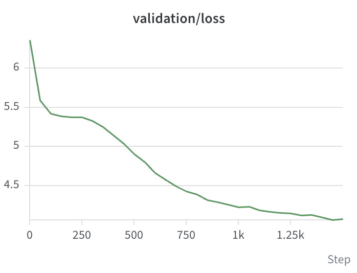
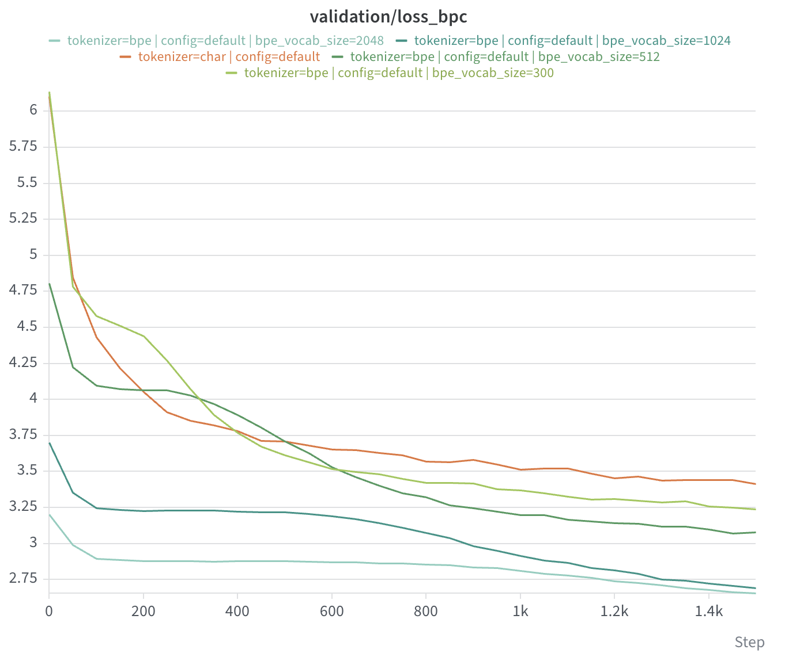

# GPT implementation from scratch

> [!IMPORTANT]
> Part of a series on contributing to AI safety and understandability by building intuition in order to ask and answer better questions
> 1. [[repo]](https://github.com/mz496/mnist) Preliminaries (LeNet; neural nets; workflow)
> 2. [here] Transformers (attention; tokenization; finetuning)
> 3. [[repo]](https://github.com/mz496/rl) Reinforcement learning (classical; RLHF; RLVR)

Following Karpathy's https://karpathy.ai/zero-to-hero.html -> Let's build GPT


## Lab notebook

### Oct 20-27

**Implemented the decoder-only transformer and some optimizations to get validation loss low enough so that the output somewhat looks like prose**

Recording loss numbers as I walk through the tutorial:

With 5000 steps,

- One attention head: val loss 2.4 (? - a bit uncertain, was not super strict in recording)
- Multi-head attention: val loss 2.4 (? - a bit uncertain, was not super strict in recording)
- Increase batch size from 8 to 32: val loss 2.26
- Adding the feedforward layer to the transformer: val loss 2.24
- Adding multiple transformer blocks: val loss 2.38

Here Karpathy starts speedrunning some things that are not super obvious in the paper (more so general neural net training tricks):

- Adding residual pathways: train loss 1.91, val loss 2.04
- Adding two layer norms around the self-attention and feed forward blocks: train loss 1.91, val loss 2.03
- Adding a last layer norm around transformer blocks: train loss 1.89, validation loss 2.01
- Adding dropout with p=0.2: train loss 2.016, validation loss 2.136. Slightly regressed; Karpathy scales up before showing these numbers but I was curious what would happen if not.

Now, upping the parameters to match Karpathy's:
```
- train_steps: 1500
- n_embd: 384
- n_head: 6
- n_layer: 6
- batch_size: 64
- block_size: 256
- vocab_size: 62
- learning_rate: 0.0003
```

- After 30 minutes of training on my macbook, I killed it early because it already reached a reasonable value, not sure exactly why my numbers were consistently slightly lower than Karpathy's though. Perhaps I was pushing the parameters harder somehow.
- Loss numbers are much improved:
  - `train:      1.2820947170257568`
  - `validation: 1.4961657524108887`

```
'buck me; being his are did so with ston.

LOUCESTER:
I do him weeth do him.

LARY ANNE:
A worthy souls thinking to brought the killy:
You tribes of like for a stand in thing
Bestay those hath Rome that to our causes.

GLOUCESTER:
Your cersel'st leave smook delow,
Arest in for every thousats.

GLOUCESTER:
Cot of no vallant alone, souf: as you, have but
I befIt it a do. Wors you bear, to bid you,
But to to you, as not in actats those,
When my praicely mon this venigh'd the warling Rome,
What in a widone? whethou heart to the say knot,
Whe woundow'st hundle the beir will joy things;
For voothous sake pobers, the own soown,
Could of Roman, by morrought.s I crave thes senderand
To know the pity and for the strews to loving
Will revenge fullie, with Jone.
I loved me, Marcius, with thou; I nay't thou have
Bad upon eyear trus you.

First Lord:
Let morkingham, I saw, as enterflew-corsen virtict teas,
Against the world ford then masters,
My povoker and give by father; ther'd, so fe
Whose inpect
```

### Oct 28

Implemented the byte-pair encoding tokenizer, and refactored the char-based tokenizer behind a `tokenizer.py` interface.

The result of BPE on the tiny shakespeare data with a target vocab size of 300, this looks reasonable so far:

```
[... 0-255 omitted ...]
  256: 101,32 ('e ')
  257: 116,104 ('th')
  258: 116,32 ('t ')
  259: 115,32 ('s ')
  260: 100,32 ('d ')
  261: 44,32 (', ')
  262: 111,117 ('ou')
  263: 101,114 ('er')
  264: 105,110 ('in')
  265: 121,32 ('y ')
  266: 97,110 ('an')
  267: 58,10 (':\n')
  268: 111,114 ('or')
  269: 101,110 ('en')
  270: 111,32 ('o ')
  271: 10,10 ('\n\n')
  272: 97,114 ('ar')
  273: 32,257 (' th')
  274: 111,110 ('on')
  275: 104,97 ('ha')
  276: 108,108 ('ll')
  277: 44,10 (',\n')
  278: 46,271 ('.\n\n')
  279: 121,262 ('you')
  280: 104,105 ('hi')
  281: 101,115 ('es')
  282: 116,270 ('to ')
  283: 114,32 ('r ')
  284: 110,111 ('no')
  285: 73,32 ('I ')
  286: 111,102 ('of')
  287: 101,97 ('ea')
  288: 266,260 ('and ')
  289: 276,32 ('ll ')
  290: 111,109 ('om')
  291: 264,103 ('ing')
  292: 119,105 ('wi')
  293: 257,256 ('the ')
  294: 32,109 (' m')
  295: 116,105 ('ti')
  296: 83,267 ('S:\n')
  297: 118,256 ('ve ')
  298: 111,119 ('ow')
  299: 115,116 ('st')
```

#### What does changing the tokenizer do to the loss?

I standardized:
- train steps = 1500
- config from before the scaleup that got the best result from Oct 27 into `default.yaml` and post-scaleup as `scaleup.yaml`

and ran this in a few different combinations, varying:
- the tokenizer (`char`, `bpe`)
- config (`default`, `scaleup`)
- BPE vocab size

When I tried this on a pure BPE vocab, I noticed that we plateau quickly then slowly taper off. For example on size 512,

- We start out at full randomness across the vocab: $\ln(512)\approx6.238$
- We then plateau at "unigram entropy" i.e. if we were strictly predicting the next char based on probability distribution of the vocab without context of past tokens: $\sum_{t\in T}p_t\ln(p_t)\approx5.345$, where $p_t$ is simply `(count of times token t appears in the text) / (vocab size)`.
  - This holds up against other vocab sizes as well; this sum $\approx 4.264$ for a vocab size of 300.



I then normalized losses to bits per character, which as expected the plateaus are lower and longer for the higher vocabs:


This is BPE with a 2048-sized vocab for roughly bits-per-char loss 2.654; where as expected it has more fully formed words, but they're chopped up and spliced together in weirder ways, and there are obviously also unrepresentable chars that come out because of the full 256 bytes we started with:

```
CLARENCEfilord, can all pro mance ; Corioliit to beseech an and your take thee in a beging: and RAKENBURYso am, L, to as ot asUCKINGHAMhis is of Roman's to and
your voider against the Forceou,
And hat, sea,
You us ho'd subhatituRoman.

wrnot glahe
that we have at that commbers, of his down firve their serv:
rus,
And to them fme goLy, trusense ,
TGod trafalLike y the So nows good conbeg thusanll lea;:
well good comGloufuse one va'Ssterll. Who hifeer well Coriolanusmost For Mamber,
Thbrother and to k minancelthere the:
And atter; not jestst this had is thou a bege, Upngreat exterpe make my 'Tis naselths fa,
�, King a will.

First Murderers, my lord, and hims sto mandiow, the people Hear of the in the g their childate?
```

Whereas the char-level one just has more local word level structure for roughly bits-per-char loss 3.412:
```
And npvontim my aveid bonSe and sata s'dovin you,
Lavel bit
Thmpivecce pyope,
Annis, gamims, marghepave 'se fase lelpes yoult in:
Go the the piven as, pmatiren yoou veam.
Thim,
To dan:
Clll noll thit habld, oo,
Therat pa goo and thaime, my niss wlow the ald the the I dou thessch trame a you thitatos hou docke,of on whet the diple ow atilud sher! grray and go drt on rist for aid swou, har thew I the obliials thath youl, tof me Sethiwim.:
Bunt E,
Mundile en anclld:
And sto to muse youe sotsild hake sorsid, benow ay ne,
Mend farlis kee thangrs bug sore am lith cor ke ius
What so thee ourzed, hiarveve. He and carutise sis bem at ckis hat:
And mys ces a o of henor fonch sreaw, a
And wrut veme.
```

### Oct 29

- I implemented the GPT4-regex-then-BPE approach from the video, which prevents joins from occurring across regex splits, and plotted loss in bits-per-char.
- I made the tokenizers always run on the train set only. Previously, I was running the tokenizer on train + validation, which was probably making bpc loss on the BPE tokenizer slightly optimistic. This isn't a problem for the char-level tokenizer since there's nothing in the validation set that's unrepresentable in the train charset.

Runs I used:
```
TODO
```